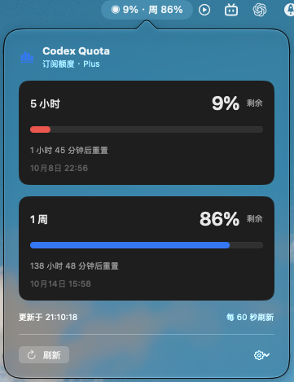

# Codex Quota

[English](README.md) | [简体中文](README.zh-CN.md)

一个原生 macOS 额度工具，通过菜单栏和可选的**桌面小组件**显示你的 **Codex 订阅剩余额度**。

```text
◉ 72% · 周 85%
```

点击菜单栏可查看进度条、重置倒计时、具体重置时间和最近成功更新时间。每 60 秒自动刷新，电脑唤醒后刷新，也支持手动刷新。

> 这是独立的社区应用，并非 OpenAI 官方产品。它新增自己的菜单栏按钮，不修改官方 Codex 菜单。界面跟随 macOS 首选语言，支持中文和英文，其他语言回退到英文。更改系统或单独为本应用设置语言后，请重启应用。

## 使用截图



截图展示中文界面；应用跟随 macOS 首选语言，支持中文和英文。

## 下载使用

当前已发布的 v1.0.2 下载包为菜单栏版本。原生桌面小组件已包含在源码中，构建安装请参见下方「macOS 原生桌面小组件」章节。

1. 安装 Codex，并使用**你自己的 ChatGPT 账号**登录。支持查找 `/Applications/Codex.app`、`/Applications/ChatGPT.app` 内置的 Codex，或单独安装的 Codex CLI。
2. 从 [Releases](../../releases/latest) 下载 **Codex-Quota-macOS.zip**。
3. 解压后将 **Codex Quota.app** 拖进“应用程序”。
4. 打开应用，额度会出现在 macOS 顶部菜单栏；没有 Dock 图标。

**运行要求：**macOS 14 或更新版本、Apple Silicon 或 Intel Mac、网络连接，以及已经登录 ChatGPT 账号的 Codex。通用下载包包含两种 CPU 架构，使用者无需安装 Swift、Python 或 Node.js。

发布包使用临时签名，**尚未经过 Apple 公证**，首次启动可能被 macOS 阻止。如果你信任下载的版本，可在尝试打开后进入“系统设置 → 隐私与安全性 → 仍要打开”，按系统提示操作；也可以自行编译。无需全局关闭 Gatekeeper。

如需开机启动，可在“系统设置 → 通用 → 登录项”中添加应用。应用不会自动修改这项设置。

## 操作

- **刷新**：立即查询。
- **齿轮 → 打开 Codex**：打开已安装的 Codex/ChatGPT 应用。
- **齿轮 → 选择 Codex 可执行文件…**：自动查找失败时，手动选择 `codex` 程序。
- **齿轮 → 隐藏菜单栏图标（保持后台运行）**：隐藏菜单栏显示，继续后台查询与组件同步；此选项包含在当前源码构建中。
- **齿轮 → 退出**：停止应用与后台额度更新。

弹出面板按内容自动收紧高度，避免底部出现大块留白；超过屏幕可用高度时才滚动，避免加载或报错时超出边界。窗口名称依据服务返回的时长显示，常见窗口为 5 小时和 1 周。缺失数据用 `—` 表示。读取失败时保留上次成功数据并标记警告；到达重置时间后，也不会自行假定额度已经恢复到 100%。

## macOS 原生桌面小组件（源码构建）

Xcode 工程包含**小号、中号**两种原生 WidgetKit 扩展。安装签名后的应用并启动后：

1. 右键桌面，选择**编辑小组件**。
2. 搜索 **Codex Quota**。
3. 选择尺寸并添加到桌面或通知中心；之后可以通过系统组件菜单随时移除。

组件操作：

- 右上角 **↻** 按钮用于刷新额度，仅显示图标。
- **正在更新…／更新成功／更新失败 · 点击重试**显示查询状态。
- **上次刷新**始终显示最近一次成功获取额度的时间，正在更新或查询失败时也会保留。首次成功获取数据前显示**尚未成功**。

现有 v1.0.2 下载包和 `scripts/build.sh` 简单构建尚不包含此扩展。构建方法：

1. 用 Xcode 打开 `CodexQuota.xcodeproj`。
2. 为主应用与扩展**两个 target**选择开发团队；如有需要，设置唯一的 Bundle Identifier。
3. 为两个 target 配置相同的 App Group。默认 entitlements 和 Info.plist 的 `QuotaAppGroup` 使用 `$(TeamIdentifierPrefix)local.codex.quota`；若团队使用不同标识，请同步修改四份配置文件。
4. 构建 **CodexQuota** scheme，将签名后的应用安装到“应用程序”，启动并同步一次额度，再通过系统“编辑小组件”添加。

刷新时提供系统加载反馈和短暂的箭头动画。查询失败会保留上次成功额度，请求中断后最多 35 秒结束待更新状态。WidgetKit 限制动画持续时间，因此箭头不会一直旋转。

菜单栏应用只将额度百分比、窗口时长、重置时间、更新时间、刷新开始结束时间和失败状态写入共享 App Group 容器。小组件不读取登录令牌，也不自行启动 Codex。需要保持应用在后台运行才能持续获取新数据。应用每 60 秒查询一次 Codex，并请求 WidgetKit 刷新；组件自身还会在 15 分钟后请求更新时间线。**实际画面刷新时机由 macOS 调度**，这些请求不保证每分钟都更新画面。点击 ↻ 会在主应用执行刷新并等待完成；点击组件其他区域也会打开应用并请求刷新。超过 3 分钟的数据会标记为待更新。

未签名构建只能检查编译，不能确认安装、共享容器访问或组件列表展示。完整安装验证和分发需要有效的签名配置。

如果只想保留桌面小组件，选择**齿轮 → 隐藏菜单栏图标（保持后台运行）**。额度查询与小组件同步会在后台继续，隐藏状态会被记住。应用运行时再次打开 Codex Quota，会重建菜单栏图标并打开额度面板。**退出**会停止后台更新，隐藏图标不会。

## 查询的是哪个账号？

应用启动本机 `codex app-server`，由它使用已有登录状态。应用没有内置作者的账号，不要求粘贴令牌，也不直接读取认证文件。分享给别人后，读取的是**对方本机 Codex 登录账号的额度**。

如果使用多个 Codex 安装位置或不同 `CODEX_HOME` 环境，应用查询的账号可能与某个已打开的桌面窗口不同。当前界面不显示账号邮箱。额度看起来不对时，请确认所选 Codex 环境；切换账号请在 Codex 中完成，之后刷新本应用。

可执行文件查找顺序：

1. `CODEX_BIN` 环境变量，适合测试或从终端启动。
2. 在应用中手动选择的路径。
3. `/Applications` 下 Codex/ChatGPT 应用内置的程序。
4. `/opt/homebrew/bin/codex`、`/usr/local/bin/codex` 和 `PATH`。

从 Finder 启动的应用可能不继承终端环境。自定义 CLI 安装位置可通过齿轮菜单选择。

## 从源码构建

安装 Apple Command Line Tools（`xcode-select --install`）或 Xcode，使用较新的 Swift 工具链。在克隆后的仓库根目录执行：

```sh
./scripts/build.sh
open "dist/Codex Quota.app"
```

默认构建当前 Mac 的架构。生成同时支持 Apple Silicon 和 Intel 的通用压缩包：

```sh
./scripts/package.sh
```

产物为 `dist/Codex-Quota-macOS.zip` 和 `dist/SHA256SUMS.txt`。构建和打包脚本只写入本仓库，不安装应用，也不注册登录项。

## 测试与排查

```sh
./scripts/build.sh
./scripts/test.sh
"dist/Codex Quota.app/Contents/MacOS/CodexQuota" --probe
```

测试使用 Python 3 启动本地模拟服务，无需登录 Codex，也无需网络。覆盖命名额度分组、字段缺失、比例边界、窗口名称、初始化握手、无关通知、错误返回、小组件快照兼容性，以及刷新成功、失败和超时状态。`--probe` 则是单独的真实接口检查，使用你的登录，仅输出剩余额度百分比。

读取失败时：

- 确认选定的 Codex 已使用 ChatGPT 账号登录，而不是仅配置 API Key。
- 检查网络连接，再点击“刷新”。
- Codex 位于其他目录时，通过齿轮菜单选择正确的可执行文件。
- 单次查询 30 秒超时，应用将在下次刷新时重试。

## 菜单栏图标恢复

如果应用正在运行却看不到菜单栏额度，请从 Finder 或 Spotlight 再次打开 **Codex Quota**。应用会重建菜单栏项目并打开额度面板。

如果仍未显示，可以先退出应用，将唯一的安装副本放到个人应用程序目录（`~/Applications/Codex Quota.app`），再从该位置启动。在一次实际排查中，同一签名应用在 `/Applications` 下获得零高度菜单栏项目，迁移到个人目录后恢复正常。迁移原生组件版本后，请确认“编辑小组件”中仍可找到 **Codex Quota**。避免在应用搜索结果中保留多个安装或构建副本。

## 可选的 Codex 配套插件

[`plugins/codex-quota`](plugins/codex-quota) 包含指导 Codex 构建、启动和诊断本仓库的技能。**运行菜单栏应用不需要安装插件。** 它没有发布到官方插件目录，这些脚本也不会自动安装插件。

仅分享插件不包含原生应用。使用技能时需保留完整仓库，并告诉 Codex 仓库位置。启用或禁用插件不会自动启动或退出应用；关闭应用请使用其“退出”菜单。

## 实现与隐私

通过官方文档中的 [Codex App Server](https://learn.chatgpt.com/docs/app-server) stdio 协议，依次发送 `initialize`、`initialized`、`account/rateLimits/read`。每次读取完成后关闭本次子进程。刷新不创建对话，也不调用模型推理。

- 优先读取 `rateLimitsByLimitId.codex`，兼容旧的 `rateLimits`。
- 剩余量为 `100 - usedPercent`，限制在 0–100%。
- 不收集使用统计，也不向本项目运营的服务器发送额度数据。
- 基础菜单栏构建不保存额度快照；签名的 WidgetKit 构建会在 App Group 容器保存最少量的额度快照。两者都不保存登录凭证；Codex 仍会维护自己的认证和运行状态。
- 仅显示 Codex 订阅额度，不显示 OpenAI API 账单余额或 ChatGPT 网页聊天的独立消息上限。
- 每分钟轮询，不是秒级推送。

二进制以 macOS 14+ 为编译目标，目前实际运行验证环境为搭载 Apple Silicon 的 macOS 26。Intel 和其他支持的系统版本仍需更多实机验证。

## 许可证

[MIT](LICENSE)。
